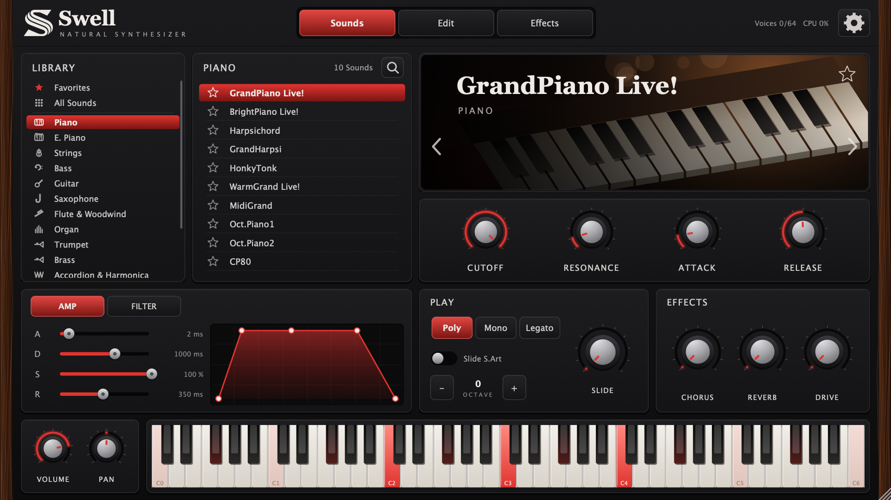

# Swell - Natural Synthétiser

Premier synthétiseur Swell Audio : sampler VST3 / AU / Standalone (macOS universel) joué à partir d'une banque de sons séparée, la **Swell Library**.

> La banque de sons (samples FLAC + index `.swellbank`) n'est **pas** incluse dans ce dépôt : elle se génère localement avec `./build-library.sh` à partir de ta propre copie de la librairie source.



## Contenu
- **Plugin** (≈11 Mo) : `~/Library/Audio/Plug-Ins/VST3/Swell - Natural Synthetiser.vst3` et `.component` (AU).
- **Swell Library** (8,5 Go, à part) : `/Volumes/SSD/Banque Kontakt/Swell Library`
  - `Swell Library.swellbank` : index JSON (catégories, sons, zones clavier/vélocité, boucles)
  - `Samples/…/*.flac` : 9 466 samples FLAC 24 bit sans perte.
  - Le plugin la retrouve tout seul ; sinon bouton en haut au centre pour choisir le dossier.

411 sons, 14 catégories, 10 767 zones, 3 391 boucles récupérées depuis les .nki d'origine.

## Interface
Onglets **Sounds / Edit / Effects**, bibliothèque avec icônes par catégorie, favoris, recherche globale, illustration par famille d'instruments, potards métal, enveloppe AMP/FILTER avec graphe, réglages (emplacement de la banque, taille 75–150 %, thèmes Rubis / Émeraude / Abysse / Ambre).

## Nouveautés 2.0
- Groupes Kontakt décodés : bruits MegaVoice/S.Art! écartés (413 zones), round-robin, couches, articulation molette.
- Hauteur juste : correction d'octave mesurée par détection de pitch (183 sons) + accordage fin ; sélecteur Octave −2…+2.
- Silence avant le signal supprimé (offset Kontakt + trim auto) ; potard Start pour ajuster.
- Slide : modes Poly / Mono / Legato + potard Slide ; vrais slides S.Art! sur les notes jouées fort.
- Favoris (étoiles), recherche globale multi-mots, Réglages (emplacement banque, taille 75–150 % + redimensionnement, thèmes).

## Moteur
64 voix, interpolation Hermite, boucles des samples, ADSR, filtre passe-bas SVF résonant,
vélocité, slide/glide, pitch bend ±2, mod wheel = vibrato (ou articulation sur les sons « mw up »), pédale de sustain, kits de batterie en one-shot.
Effets master : drive, chorus, reverb, volume, pan, limiteur doux.

## Rebuild
```bash
./build-mac.sh                 # plugin
./build-library.sh             # banque (NKI -> index, NCW -> FLAC)
cmake -S . -B build -DSWELL_BUILD_TESTS=ON && cmake --build build --target SwellRenderTest
./build/SwellRenderTest_artefacts/Release/SwellRenderTest /tmp   # test headless + capture UI
```

## Outils
- `tools/nki_to_bank.py` : lit les .nki Kontakt 5 (FastLZ niv. 1/2) → mapping + boucles.
- `Source/NcwDecoder.h` : décodeur NCW (delta / absolu / brut, mid-side), vérifié au bit près.

Usage personnel : les samples proviennent d'un rip du Yamaha PSR-S900 — ne pas redistribuer la banque.
